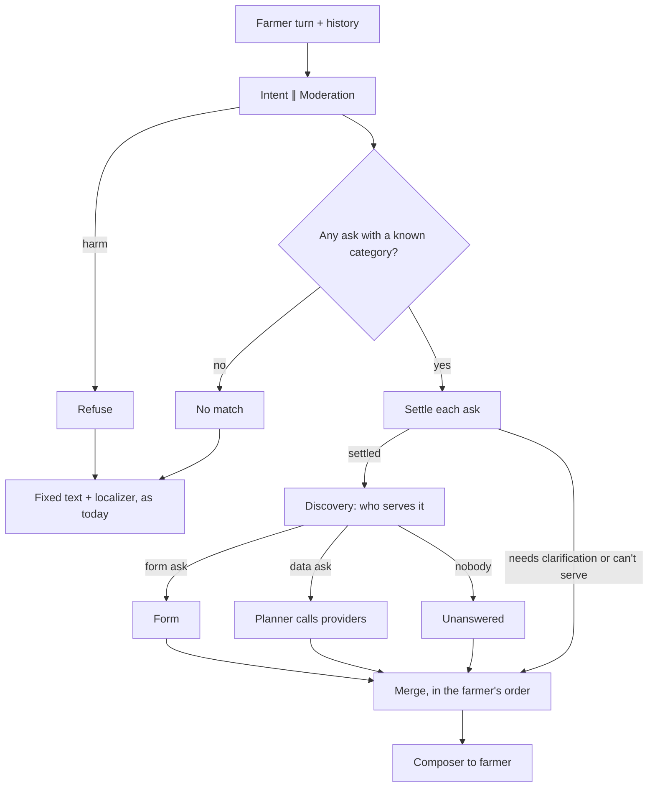

# Spec: Farmer with a scheme problem is guided to a grievance (#243)

Story: https://github.com/OpenAgriNet/engineering-tracker/issues/243
Epic: #204
ADR: [ADR-0022](../../ADR/0022-settle-each-ask-before-serving-it.md), settle
each ask before serving it.

## Approach

**Settle each ask before serving it.** An ask has slots: the facts it must
have before we can serve it. Settled means every slot is filled, or we know
we cannot serve it. An ask that is not settled ends the turn with one
question. The next turn reads our question from the history (ADR-0017). No
store.

This is frame-based slot filling, as in Rasa forms or Amazon Lex. Code
decides which slots an ask needs. The model only reads the values from the
farmer's words.

**Steps.**

1. Intent finds each ask's category. No ask with a known category means
   `no_match`, as today.
2. Settlement runs right after intent, from local data only: the schema
   packs and the form registry. It fills or flags each slot.
3. Unsettled asks skip discovery and the planner. The turn is
   `requires_input`, and the composer asks one question.
4. Settled asks go on as their own `Intent`: discovery, then the form step
   or the planner, even when another ask in the turn is unsettled. "Nobody
   serves it" is still found by discovery and ends as "can't serve".
5. Every reply in this story goes through the composer.



Refusal and no-match stay fixed text for now. They move to the composer in
a later story, using the turn-level part of `Evidence` added here.

**Which slots an ask needs.** Worked out from what exists. No new config.

| Slot | Needed when | Values from |
|---|---|---|
| place | the category's pack mentions a location (`needs_place`, #107) | intent's place name, resolved as today |
| scheme | the form key for the category needs one | intent's scheme code, checked against the catalog |
| action | the category has forms with more than one action | intent's action pick; no default |

Where the index lists more than one pack for a category, a place is needed
only if every pack mentions a location. So Crop and Livestock do not ask.
Whether the index should list AgricultureFacility under Crop at all is a
separate issue.

**Every slot value comes with how sure intent is of it.** Code fills a slot
only when intent is sure and the value checks out. Unsure means we confirm
or ask.

**How each slot is asked.**

- **action:** asked when unclear, never guessed. A wrong guess costs too
  much either way: guessing file risks a duplicate complaint, and guessing
  status asks for a ticket the farmer may not have.
  - Clear words ("I want to complain", "what happened to my complaint", a
    ticket number): filled.
  - Unclear ("my payment did not come"): "Do you want to raise a new
    complaint, or check one you already raised?" The question uses the
    farmer's words, never "file" or "status".
- **place:** as today: an open question, or a pick list of at most 5
  (ADR-0017).
- **scheme:** never a list. "Which scheme is this about?" Only schemes we
  can serve count: the ones with a form for this category and action. The
  model matches the reply.
  - Sure match: filled.
  - Close but unsure: confirm. "Do you mean PM Fasal Bima Yojana?"
  - No match: say so and ask again. No retry count; the farmer can leave.
  - Named, but no form for it here: can't serve, no question. Asking again
    would go in a circle.

The model reads the action from what the farmer wants, not how they say
it. "How do I file" is file. "How do I check the status" is status.

**One question per turn.** The first missing slot, in ask order. Within an
ask: action, then scheme, then place. Action goes first because it is the
bigger fork, and it stops a duplicate complaint early. The next slot comes
on the next turn. A vague scheme problem takes three turns: action, scheme,
then the form. `settle` lists every open slot. For now the composer asks
about the first one only. Later, a per-channel rule in the composer's code
decides how many to ask (voice one, web all).

**The composer writes the question.** It gets the missing slot as evidence
and words the sentence in the farmer's language. Exact parts, such as a
place pick list, are added by code after the prose, as form blocks are
today. If the composer fails, we send the fixed English question through
the localizer, as today.

**Intent examples are config.** `configs/intent-examples.yaml` holds
example phrasings per category, in any language, with the action where it
applies. At most 5 per category (`DSS_INTENT_EXAMPLES_MAX`, default 5). An
unknown category, an unknown action, or too many lines fails at boot. The
template renders them; the wording stays in `prompts/intent/`.

**Rejected**

- *The agent asks* (an `ask_farmer` tool for the planner). Can't promise
  "never asks for a place". A model call every turn. Hard to test.
- *Intent writes the question.* Intent can't see which slots a pack needs.
- *A state machine per use case.* Every new use case needs code.
- *A stored dialogue state.* The story rules out a store; ADR-0017 chose
  the history.
- *Settle after discovery.* The packs are local, so the slots are known
  after intent. Asking before discovery can cost one wasted answer when
  nobody serves the category. That is rare.
- *A list of schemes.* A catalog can hold many. The model matches the
  reply instead.
- *Action from the interaction type.* "How do I file" is advise and got no
  form. Action is its own slot.
- *Default the action to file*, with an "if you already filed" line on the
  form. Risks duplicate complaints when the farmer skips the line.
- *Default the action to status.* A farmer who never filed has no ticket
  and is stuck.
- *A `missing` field next to `awaiting`.* Allows a form and a question on
  one ask. One outcome per ask instead.
- *Two intent calls* (category, then action). Adds a call to every
  grievance turn.
- *An examples file per language.* Farmers mix languages. One file, any
  language.

## Data model

### `Evidence` (`core/planner/models.py`)

Today:

```
Evidence
  sources
  per ask: ask, results, failures, awaiting
```

After:

```
Evidence
  turn_note: none                        ← new, empty in this story
  sources
  per ask: ask, outcome
```

- **`turn_note`**, a fact about the whole message. `TurnNote` is an open
  base with no kinds yet, the same pattern as `TurnInput` and
  `OutputBlock`. Always `None` in this story. It is added now so refusal
  and no-match can use it later without another shape change. The code
  comment says so.
- **`outcome`**, exactly one per ask (`AskOutcome`):

| Outcome | Holds | Comes from | Lands in |
|---|---|---|---|
| `NeedsClarification` | the open slots, in order | settlement | task 2 |
| `CannotServe` | the slot that ends the ask | settlement | task 2 |
| `Attempted` | results, failures | the planner | task 1 |
| `AwaitingInput` | the form; later an OTP request | the form step | task 1 |

  `Attempted` with no results is unanswered: the farmer is told so.
  `AwaitingInput` waits for a structured input, read by its own path.
  `NeedsClarification` waits for words, read by intent. `NeedsClarification`
  and `CannotServe` are settlement's own results, stored as they are.

  The composer sees only the first open slot. Its state says what to ask:
  missing → open question, ambiguous → pick from the choices code lists
  below the reply, not found → say so and ask again, too broad → ask for a
  smaller one.
- `Evidence` now means "what we know per ask", not only provider data. The
  docstring says so.
- An ambiguous or unknown place stops being a `Failure` and becomes
  `NeedsClarification`.

### Settlement (`core/settlement/`)

- `Frame`: an ask's slots, in order. `Slot` = name and state.
- `SlotState`, a closed set: `Resolved(value)`, `Ambiguous(value, choices)`
  (the value is the name the question is about: what the farmer typed when
  they pick, our one guess when they confirm),
  `Unresolved(value, reason)` (not found, too broad), `Missing`,
  `Unservable(reason)`. A new slot needs no new state. `Skipped` comes with
  voice forms.
- `settle(frame) -> Settled | NeedsClarification | CannotServe`. Pure, and
  reads only each state's `is_settled` and `ends_ask`. Any slot that ends
  the ask → can't serve; else open slots → needs clarification; else
  settled.
- **Ask slots** are a fixed `AskSlot` enum, read from the ask's own fields
  (`ask_slot_state`). **Form fields** are named by the pack, and are filled
  by the form step later (voice).
- **Which slots an ask needs** comes to settlement as an `AskNeeds`, one
  per ask. The wiring (`orchestration/turn.py`) works it out each turn from
  the current capability index, since the index can refresh. Settlement
  reads no pack and no registry, so a new slot adds a field, not a
  parameter.
- **Branch and merge:** `run_turn` settles each ask, then runs only the
  settled asks as their own `Intent`. `merge_unsettled` puts their evidence
  back beside the unsettled asks, in the farmer's order. Passing the ask
  itself instead of its index would remove the merge (`TODO.md`, "Ask
  identity").

### Intent (`core/intent/models.py`)

- `ClassifiedAsk.scheme_confidence`: `high` or `low`, set by the model.
  `high` means the farmer's words name the scheme. Two levels, not a
  number: a number needs a cut-off, and models rate themselves badly.
  Left out counts as `low`. Code still checks the code against the catalog.
- `Ask.scheme` is a `Scheme` (high), a `GuessedScheme` (low) or nothing. A
  guess keeps the farmer's words as the subject and never picks a form.
- `ClassifiedAsk.unlisted_scheme_name`: the name the farmer said, when it
  is none of the listed schemes. The ask then carries an `UnlistedScheme`.
  Settlement reads it as not found: we say so and ask again.
- `ClassifiedAsk.action: str | None` and `action_sure: bool`. Picked from
  the category's form actions shown in the prompt. Checked against the
  registry; unknown is dropped and the action is asked.
- `IntentExample`: text, category, action (optional). Loaded from config.

### Forms (`core/forms/registry.py`)

- A way to ask which contexts exist for a category: the schemes and
  actions a category can serve.

### Removed

- `form_offer._ACTION_BY_INTERACTION` and its reverse. The action is a
  slot now.
- `_place_clarification`, `place_optional_asks` and the `trailing_question`
  path. Settlement and the composer take them over.

## API contracts

No wire change. A question turn ends `requires_input` with a text block,
plus any exact block code adds.

## Edge cases

- **Vague scheme problem** ("payment did not come"). Asks new or existing
  complaint first, then which scheme. Never a place.
- **Clear action, scheme not named.** Asks "which scheme" only.
- **Clear action and scheme in the first turn.** Form offered in the same
  turn.
- **"How do I file a complaint".** Action is file, so the file form comes.
- **A ticket number in the message.** Action is status.
- **Two asks, one unsettled.** The settled one is answered. The composer
  asks about the other in the same reply.
- **Two asks need the same slot** (weather and mandi, no place). One
  question answers both.
- **The farmer answers both open asks at once.** Both settle that turn.
- **Reply is a new question.** Intent treats it as new, as for places.
- **No scheme has a form for this category.** Can't serve, no question.
- **Nobody serves the category.** Found by discovery after settlement.
  Can't serve. The farmer may have answered a question for nothing; rare.
- **A new scheme or form pack.** Read at boot. No code change.

## Failure modes

- **Composer fails on a question turn.** Fixed English question plus the
  localizer.
- **Intent drops the grievance on the reply turn.** The reply is read
  fresh. One wasted turn. Covered by intent examples and a tier-5 test.
- **Intent misreads its own question.** Wrong form, one extra turn. The
  story's named risk. Asking the action, not guessing it, keeps the wrong
  form rare.
- **Examples file wrong.** Boot fails, naming the line.

## Implementation tasks

1. `Evidence` reshape: the turn-level part and one outcome per ask. Move
   today's readers over. No behaviour change.
2. Settlement types and `settle`, starting with place. Replace
   `place_optional_asks` and the place question path. Place behaviour
   unchanged, except a place we cannot find is asked again.
3. Scheme slot: registry contexts by category, intent's
   `scheme_confidence`, confirm and no-match handling.
4. Action slot: intent's `action` and `action_sure`, the question when
   unclear, drop the interaction mapping. Covers the flaky portal case: "I
   cannot log in to the PMFBY portal…" is read as advice about 4 times in
   10 today. The scheme is `Unservable` only once the action is known.
5. Intent examples config: loader, boot checks, cap, template.
6. Composer writes the question; fallback to fixed text; exact parts after
   the prose.
7. Docs: `DSS_ARCHITECTURE.md`, `AGENTS.md` tech
   stack, changelog. Update #243's criteria: no scheme list, a confirm
   when unsure, and the action asked when unclear (criteria 1, 2 and 4,
   assumption 1).

## Test strategy

- **Tier 1:** `settle` for each slot and state; outcome rules on
  `Evidence`; examples loader and boot checks.
- **Tier 3:** orchestrator stops on an unsettled ask before discovery;
  composer gets the question; fallback on composer failure.
- **Tier 5:** intent picks Grievance for loose phrasing, the action, and
  `scheme_confidence`. Structure only.
- **Tier 7:** one smoke: scheme problem, "which scheme", reply, form.

## Reuse from the earlier branch

`feat/243-guided-grievance` (PR #158, draft) built a different design:
settle after discovery, a `missing` field beside `awaiting`, and action
from the interaction type. Worth reusing: the registry's
`contexts_for(category)`, the intent structural tests, and the e2e smoke.
Its "already filed" line is not needed here: the action is asked instead.
