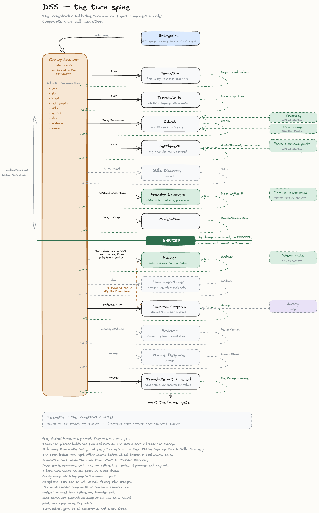

# DSS design — from turn to answer

Draft 2. Rewritten after review.

---

## 1. What this is

A farmer asks a question, in their own language. The DSS works out what they need, finds who
can answer, and returns an answer with its sources. It keeps no conversation. It holds a
short-lived session, which form flows need (ADR-0022).

So where does this thing actually live?

---

## 2. Where it sits

**As its own container.** The Experience API(Not ready yet, Check link to get more details on expericnce layer) calls it over HTTP.

Three reasons:

**It is self contained.** A shipped library only works if their service is Python, and then
forces their Python version, their dependency resolution, and an async runtime.

**Nothing is foreclosed.** The door stays open. `core/` never imports the transport. So we can merge the two into one process later if we want.

**The two scale differently.** The DSS waits on LLM calls and is slow. Experience is I/O-bound
and fast. Scaling them together wastes replicas.

### Streaming across the boundary

One `POST`, many events back on the same open connection. Server-Sent Events.

1. Experience posts the query. The connection stays open.
2. The DSS runs the turn. Nothing is sent yet.
3. The composer starts writing. Each piece goes out as it is ready.
4. One terminal event. The connection closes.

The caller can also ask for one JSON body in place of the stream. The `Accept` header picks.

Experience does the same to its own caller — it forwards each chunk as it arrives.

**The stream cannot be resumed today.** If the connection drops mid-turn, the DSS stops the
turn. The caller asks again.

**Two connections can drop, not one** — farmer to Experience, and Experience to DSS. The
farmer's is the fragile one: patchy mobile data, a dropped voice call.

**Resumability is open.** [Open #11]

So how does one question actually get answered?

---

## 3. The shape of a turn



Source: [dss-orchestration.excalidraw](dss-orchestration.excalidraw). Grey dashed boxes are
planned and not built yet.

### What comes in

```python
class UserTurn:
    input: TurnInput                  # what the user sent: text, or a filled form
    session_id: str
    transaction_id: str               # the caller's id for this turn
    source_lang: LanguageTag          # language the user spoke or typed
    target_lang: LanguageTag          # language the answer comes back in
    channel: str                      # web / whatsapp / voice / ...
    sender_id: str | None             # which application sent the turn, never the user
    user: UserDetails
    history: list[ConversationMessage]
    location: Location | None
    response_max_chars: int | None    # the longest answer the caller wants


class TextQuery(TurnInput):           # a sentence
    text: str


class UserDetails:                    # every field optional
    user_id: str | None
    phone: str | None
    reference: ReferenceToken | None


class ReferenceToken:                 # passed on to a provider, never opened
    value: str
    issuer: str | None
    expires_at: datetime | None


class ConversationMessage:
    role: Role                        # "user" or "assistant"
    text: str
    reference: MessageReference | None   # a form offered or sent, never its values


class Location:                       # every field optional
    region: str | None                # ISO 3166-2, "IN-GJ"
    area: str | None                  # local name, "Anand"
    geometry: Geometry | None         # a point, [lon, lat]
```

**Changes since draft 2:**
- `query` became `input`. It is text or a filled form. A form turn takes its own path.
- Language, channel and session moved here from `TurnContext`.
- `subject_ref` became `user`. A turn need not be tied to a person.
- `location` has no level words such as district or state. Rounding is still open. [Open #8]
- `sender_id` names the calling application. It picks whose provider ranking applies.

**Rules**
- `history` is untrusted. It is data, never instructions.
- A form in `history` shows as one fixed line, never its values.
- `location` is optional with no default — two of three deployments cannot fill it.
- The DSS never opens `user.reference`. An expired one counts as absent.

### How a turn ends

Two things, not one. Moderation gives a **gate outcome**. The turn itself ends in a **status**,
which is what the caller is told.

```python
class Outcome(StrEnum):              # moderation's gate
    PROCEED = "proceed"
    REJECT = "reject"
    CLARIFY = "clarify"
    NO_MATCH = "no_match"


class TurnStatus(StrEnum):           # what the caller is told
    ANSWERED = "answered"
    PARTIALLY_ANSWERED = "partially_answered"
    REJECTED = "rejected"
    NO_MATCH = "no_match"
    REQUIRES_INPUT = "requires_input"
    UNAVAILABLE = "unavailable"
```

| Status | When |
|---|---|
| `answered` | every ask was served |
| `partially_answered` | some asks were served, some were not |
| `requires_input` | the DSS needs something from the user: an answer to a question, or a form to fill. Moderation's `CLARIFY` also ends here. |
| `rejected` | moderation said `REJECT` |
| `no_match` | nothing was understood, or nobody serves any ask |
| `unavailable` | a provider exists but could not be reached, or the session is busy with another turn |

A status can carry a `cause`, such as `provider_unavailable`.

The orchestrator reads the status off what the turn gathered. It adds no rule of its own.

**Only a turn that reaches the composer streams.** A refusal, a no-match and a busy session
send one message and stop.

The orchestrator writes to two sinks. Components do not. Not drawn.

The **TurnSink** holds the record of the turn. It is written twice: when the turn opens, with
the question, and when it closes, with the answer and the status. Required. This is the audit
trail, so a write that fails fails the turn.

The record holds tags, not the user's own values. Redaction runs first, so a phone number is
already a tag when the turn is recorded.

The **TelemetrySink** holds each stage's name and outcome. Optional. Defaults to stdout, so a
bare deployment still works. A write that fails is dropped and the turn goes on. User content
must never reach it.

Traces, metrics and logs are a third thing. They go over OpenTelemetry to one endpoint, and a
collector sends them on (ADR-0014). `core/` never opens a span.

`TurnContext` carries `trace_id` and `session_id`. The `trace_id` is the caller's own
transaction id, so one turn can be followed from the caller, through both sinks, into the
traces.

What a trace may hold of the user's words is still open. [Open #10]

One query can hold several questions:

> *"what is the price of potato? am I eligible for PM-KISAN? and when should I sow potato?"*

```python
asks = (
    Ask(id=0, agriculture_subjects="potato",   subject_categories=MARKET, interaction_type=OBSERVE),
    Ask(id=1, agriculture_subjects="PM-KISAN", subject_categories=SCHEME, interaction_type=OBSERVE),
    Ask(id=2, agriculture_subjects="potato",   subject_categories=CROP,   interaction_type=ADVISE),
)
```

The `id` is given once and never changes. Every later step names the ask by it.

An ask can also carry three facts: a `place`, a `scheme` and an `action`. Each is empty when
the ask does not need it. Section 6 covers them.

Each ask is handled on its own. It gets its own providers, its own calls and its own part of
the answer.

There is a hard line halfway down that diagram: the barrier. Everything above it can be thrown
away. That includes a discovery query, which only reads. Everything below it cannot — a Provider
call may already have happened.

Today the Planner sits below the line, because it builds the plan and also makes the calls. It
starts only when moderation says `PROCEED`.

*Future scope:* when the Plan Executioner is built, the line moves down to sit above it. The
Planner may then build a plan while moderation is still deciding. We want to try that, but it
is not built.

That barrier shapes who is allowed to call whom.

---

## 4. The orchestrator

The **entrypoint** takes the API request, builds `UserTurn` and `TurnContext`, and calls the
orchestrator once.

The **orchestrator** holds the turn and calls each component in order. Components never call
each other — every one takes plain objects and returns plain objects.

```python
class TurnContext:
    trace_id: str      # the caller's transaction id, sent back as traceId
    message_id: str    # the caller's, or one the entrypoint makes
    session_id: str
    sender_id: str     # who called; picks the provider preference
```

`TurnContext` holds the ids an answer is filed under. The languages and the channel are on
`UserTurn`, since they describe the question.

Illustration only — not the implementation. It shows who calls what and what is held:

```python
async def run_turn(turn: UserTurn, ctx: TurnContext) -> AsyncIterator[ChannelChunk]:
    intent = await classify(turn, taxonomy, ctx)

    skills_task                = discover_skills(turn, intent, ctx)
    provider_candidates_task   = discover_providers(intent, turn, ctx)     # all three run together
    moderation_verdict_task    = moderate(turn, intent, ctx)
    skills     = await skills_task
    discovered = await provider_candidates_task      # DiscoveryResult

    plan     = await plan_turn(turn, intent, skills, discovered, schemas,
                               moderation_verdict_task, ctx)
    evidence = await execute(plan, ctx)
    answer   = compose_response(evidence, plan, identity, ctx)

    async for chunk in shape(answer, ctx):
        yield chunk
```

`turn` and `ctx` stay in scope for the whole turn. That is why moderation gets `UserTurn`
without anything passing it along.

Order is code, not config. The sequence above — classify, then fan out, then plan, then
execute, then compose, then shape — is what `run_turn` does. Nothing outside this function
decides that order.

**Composition of components** We are not thinking of composing component through yaml, it will be using
python code. We can declare what all components can be optional and those components can be turned off through
config. For example **Moderation** is a mandatory component where as **Response Review** can become an optional.

**Keep it extensible.** As of now we are not able to for-see how much extensibility we should add, we want to
avoid adopter adding the code, instead they should be able to extend by configs, mcp tools, policies, hooks(this is still open).

    *Reason why we should avoid extention via code is simply because you will not be able to control what kind of code adopter will run, though we can provide some reference, test suits etc, there can still be loop holes. So we should come back to this point when we have a strong reason to allow and with proper governance and quality and security checks in place*

### What runs today

The illustration above is the target. This is what the code runs:

```python
async def run(turn, ctx):                    # one turn at a time per session
    turn, real_values = redact(turn)
    turn = translate_in(turn)

    decision ∥ (intent → places → settlement → discovery)    # run side by side
    if decision.outcome is not PROCEED:      # the barrier
        return refusal(decision)             # one message, no stream

    evidence = plan(turn, discovery, decision)    # builds the plan and runs it
    for piece in compose(evidence, turn):
        yield reveal(translate_out(piece), real_values)
    yield TurnFinished(status_for(evidence))
```

- **Moderation runs beside the rest.** Intent, place lookup, settlement and discovery run in
  one chain. Moderation runs next to that chain (`anyio`, ADR-0005).
- **The barrier is a gate.** The planner is reached only on `PROCEED`. Discovery may have run
  by then. It only reads.
- **The planner builds the plan and runs it.** There is no separate executioner.
- **A form turn takes its own path.** The orchestrator picks the path by the kind of input.
- **Not built:** Skills Discovery, Plan Executioner, Reviewer, Channel Response. They have
  no stubs in the code.
- **Wiring is code, not config.** The components are built once at startup, behind `ports`.

### The form flow

Some asks end in an action on a provider, not an answer: filing a grievance (`support`) or
checking one (`status`). The provider needs facts from the user, so the DSS sends a form.

1. **A text turn offers the form.** Intent finds the scheme and the action. Settlement finds
   the form for them, from the schema pack. The answer carries the form, and the turn ends as
   `requires_input`.
2. **A form turn sends it back.** The values are checked against the form and redacted.
   Moderation judges the free text.
3. **The DSS finds the provider** for the scheme and calls `support` or `status`.
4. **The composer streams the provider's reply.**

**Some schemes need a first step.** When the pack says so, the DSS calls `init` first, for
example to send the user an OTP. A second, small form takes the user's reply. Then the real
call is made.

**A form is filed once.** The session remembers a filed form. This is why form flows need the
session store (ADR-0022).

Before the orchestrator can run a single turn, some things have to exist already.

---

## 5. What exists before the first turn

Built once, before any turn.

| Built | From |
|---|---|
| `Policies` | DSS defaults + adopter's own |
| `Taxonomy` | categories: from schema and subjects: planned |
| Schema packs | `network-specs` packs, read from disk. Fetched first if the folder is empty |
| Scheme list | `configs/schemes.csv` |
| Place list | the area CSV |
| Prompts and skills | `configs/prompts.yaml`. Checked at startup |

Today all of this is read once at startup. A change needs a restart.

*Future scope:* refresh on an interval, or by an API call, without a restart.

### Policies

A policy is a rule saying what the DSS must not do. Loaded and checked at startup, then
applied at fixed points in the turn.

```python
class Policy:                    # every policy has these
    id: str                      # "no-pesticide-dosage"
    checkpoint: Checkpoint       # where it is applied. MODERATION by default
    description: str
    fail_mode: FailMode          # CLOSED by default

class WordCheckPolicy(Policy):   # no model
    words: list[str]
    warning: str                 # told to the user when a word is taken out

class LlmPolicy(Policy):         # judged by a model
    on_violation: Outcome        # the gate outcome from section 3
    signals: list[str]
    examples: list[PolicyExample]


class Checkpoint(StrEnum):
    MODERATION = "moderation"
    PRE_TOOL_CALL = "pre_tool_call"
    POST_RESPONSE = "post_response"
```

**Two kinds.** A word check takes listed words out of the question and warns the user. It
never refuses the turn (ADR-0002). An LLM policy gives signals and examples, and a model judges
the question against them.

**Three checkpoints, one built.** Moderation exists. Pre-tool-call and post-response are named
but not designed. See **6.3 Moderation**.

**`fail_mode` is what happens when the check itself breaks.** `CLOSED` blocks the turn. That is
safe, but an outage then refuses honest users. `CLOSED` is the default.

**One pack is loaded.** The DSS ships a default pack. An adopter can point
`DSS_POLICY_CONFIG_PATH` at their own, and it is used in place of the default. A misspelled
field or a missing file stops the startup.

*Future scope:* an adopter adds to the DSS pack instead of replacing it. Some DSS policies
cannot be turned off.

Full schema and the loader: `0003-policy-schema.md`.

### Taxonomy

Planned. The model is to be added.

Today Intent uses the categories from the schema. See **6.1 Intent**.

### Schema packs

A schema pack says what one kind of thing on the network looks like. The network owns the
packs ([network-specs](https://github.com/OpenAgriNet/network-specs/tree/main)). The DSS reads
them and never writes them. [Dependencies #1]

The packs are read from disk at startup. If the folder is empty, they are fetched first. A
pack that cannot be read is skipped and logged.

The DSS uses a pack in three ways:

- **To find providers.** An index maps an ask's category and interaction to the pack's
  `@type`. Discovery searches for that type. The pack also says whether the ask needs a place.
- **To call a provider.** The planner sees the fields it may filter on. Its choice is checked
  against the pack before the call. The DSS adds `@context` and `@type` from the pack.
- **To build forms.** A pack that ends in an action gives the form the user fills.

*Future scope (proposed):* the network spec defines only the envelope. The provider maps its
own API with very few fields. The contract carries enough description for the model to tell
which API to call, and how.

See **6.5 Provider Discovery** and **6.6 Planner Agent**.

### Prompts and skills

Each model component has a prompt per language. `configs/prompts.yaml` names them. English is
required. A language with no prompt of its own falls back to English (ADR-0018).

A skill is a markdown file: a short header, then the guidance. The header names the tools the
skill needs. The same config file names the planner's skills, per language. One ships today:
`provider-invocation`. It is about how to call the network.

Both are checked at startup. A missing file, a missing header field or a wrong placeholder
stops the startup.

*Future scope:* behaviour skills. An admin adds skills per topic, to shape how the DSS behaves
for a use case. Skills Discovery then picks the ones a turn needs. See **6.4 Skills**.

With that in place, here is what each component in the diagram actually does.

---

## 6. The components

### 1. Intent

A farmer asks in their own words. Intent turns that sentence into labels the rest of the
pipeline can use.

It addresses 3 things:

- **How many questions** were asked. One sentence often holds several.
- **What each is about.** A category, and the subject if named.
- **What kind of answer** is wanted. Advice, a lookup, or an action.

Intent does not answer, fetch, or pick who to call. It only labels. Everything after this reads
the labels, not the raw query.

```python
class InteractionType(StrEnum):
    ADVISE = "advise"     # explain/guide
    OBSERVE = "observe"   # look up a value/record/status
    ACT = "act"           # perform an action


class SubjectCategory(StrEnum):
    CROP = "Crop"
    LIVESTOCK = "Livestock"
    WEATHER = "Weather"
    MARKET = "Market"
    SCHEME = "Scheme"
    FACILITY = "Facility"
    GRIEVANCE = "Grievance"    # a complaint. Ends in a form, not an answer


class Ask:
    id: AskId                  # given once, never changes
    agriculture_subjects: str | None
    subject_categories: SubjectCategory
    interaction_type: InteractionType
    place: ResolvedPlace | AmbiguousPlace | UnresolvedPlace | None   # see Filling the place
    scheme: Scheme | GuessedScheme | UnlistedScheme | None
    action: RequestedAction | UnclearAction | None


class Intent:
    asks: tuple[Ask, ...]
    confidence: float
```

```python
classify_intent(turn: UserTurn, llm: LLMProvider) -> Intent
```

**An ask may carry three facts.**
- `place`: where the ask is about. Empty when no place applies.
- `scheme`: a `Scheme` when the user named one on the scheme list. A `GuessedScheme` is the
  closest match, and must be confirmed with the user. An `UnlistedScheme` is a name that is not
  on the list.
- `action`: `support` raises something new. `status` checks one already raised. `unclear`
  means the user wants something done but did not say which. Empty means they only want an
  answer.

The model never makes up a scheme. It picks a code from the list it is shown, and code turns
that into the scheme.

Settlement checks these facts before any provider is searched for (ADR-0023).

*Future scope:* an ask will also carry a `capability`, beside its subject. The list of
capabilities will come from the network API, the same way the categories do, and Intent will
pick from it. Examples: `KnowledgeAdvisory`, `MarketPrice`, `WeatherObservation`,
`WeatherForecast`, `GrievanceFiling`, `GrievanceStatusCheck`, `SchemeEligibilityCheck`.

**One sentence can hold several questions.** Each becomes an ask.

*"what is the price of potato? am I eligible for PM-KISAN? and when should I sow potato?"*

```python
asks = (
    Ask(id=0, agriculture_subjects="potato",   subject_categories=MARKET, interaction_type=OBSERVE),
    Ask(id=1, agriculture_subjects="PM-KISAN", subject_categories=SCHEME, interaction_type=OBSERVE),
    Ask(id=2, agriculture_subjects="potato",   subject_categories=CROP,   interaction_type=ADVISE),
)
```

**Rules**
- Empty `asks` means "understood nothing". A valid answer, not an error.
- The category must be one from the list.
- `agriculture_subjects` is the farmer's own word. Nothing resolves it to an id — see [Open #7].
- The ask carries no query text. The query stays whole in `UserTurn`.
- Each ask is handled on its own.
- Three asks does not mean low confidence.
- A timeout must raise. Never return a made-up Intent.
- `place` is never invented. The model never produces a coordinate. See **Filling the place**
  below.

#### Filling the place

Intent's result carries a place for each ask. The model returns the place as words. A lookup
that runs right after it turns the words into a place. The model never produces a coordinate,
because a model asked for one invents it.

*Future scope:* the lookup becomes a tool that Intent calls.

**Place is per ask, not per turn.** Each ask carries its own `place` — a turn naming two
places is two asks, each grounded where it says.

*"Wheat price in Pune, and will it rain in Anand?"* is two asks, two places:

```python
asks = (
    Ask(agriculture_subjects="wheat", subject_categories=MARKET,  interaction_type=OBSERVE,
        place=ResolvedPlace(name="Pune",  within=("India", "Maharashtra"), ...)),
    Ask(agriculture_subjects=None,    subject_categories=WEATHER, interaction_type=OBSERVE,
        place=ResolvedPlace(name="Anand", within=("India", "Gujarat"), ...)),
)
```

A farmer who names no place at all still gets an answer if their device sent a location, or
the platform already asserts one — see precedence below.

**A resolved place is a chain of ancestors, coarsest first, no level words** — e.g.
`within=("India", "Maharashtra", "Pune")`. Nothing says "state" or "district": a Kenya adopter
fills the same chain with counties, code unchanged. Same idea as GeoNames, Who's On First,
Photon.

```python
class PlaceSource(StrEnum):
    NAMED = "named"                          # the farmer said it, this turn
    CARRIED = "carried"                      # carried across turns in the same session
    ASSERTED_AREA = "asserted_area"          # platform's turn.location.area
    ASSERTED_GEOMETRY = "asserted_geometry"  # device's turn.location.geometry
    NEAR_USER = "near_user"                  # a whole state was named; this is the user's own place in it


class ResolvedPlace:
    name: str
    within: tuple[str, ...]       # coarsest first, no level words
    geometry: Geometry
    source: PlaceSource


class AmbiguousPlace:             # a name that matched more than one place
    unresolved_name: str
    candidates: tuple[AreaMatch, ...]


class UnresolvedPlace:            # a name the index does not carry
    unresolved_name: str
    region: str | None            # set when the name is a whole state: ask for a smaller place
```

**Three outcomes when a place doesn't resolve, not one.** `AmbiguousPlace` (name matched
several areas), `UnresolvedPlace` (matched none), plain `None` (nothing named, no fallback — or
the ask needs no place, e.g. "how do I grow potatoes"). Three different shapes, not one failure
flag.

**Precedence, per ask:**
```
place the ask names (this turn, or carried from earlier)
  > device geometry (turn.location.geometry)
  > platform-asserted area (turn.location.area)
  > place a sibling ask in this turn already resolved
  > nothing
```

Device geometry outranks the platform-asserted area: live location sent this turn is fresher
than an area the platform is only repeating from an earlier one.

**Multi-place turns are two asks, not a list.** "Weather in Pune and Mumbai" splits the same
way two subjects in one sentence already split (see "tomato price and when should I spray"
above), rather than `place` ever holding more than one location:

```python
asks = (
    Ask(agriculture_subjects=None, subject_categories=WEATHER, interaction_type=OBSERVE,
        place=ResolvedPlace(name="Pune",   within=("India", "Maharashtra"), ...)),
    Ask(agriculture_subjects=None, subject_categories=WEATHER, interaction_type=OBSERVE,
        place=ResolvedPlace(name="Mumbai", within=("India", "Maharashtra"), ...)),
)
```

**The area lookup is a port — the CSV is one implementation, not the only one.** The design
converges on `AreaLookup` supporting more than a static file:

| Implementation | What it is |
|---|---|
| CSV (shipped default) | A local index built from an LGD-style snapshot, read once at startup. Works with no network dependency. |
| Photon | An OpenStreetMap place search over HTTP. Tried after the CSV, when it is set up. |

*Future scope:* an adopter can add their own place resolution as an MCP tool. This comes once
MCP tools integration is enabled.

`core/` only ever sees the port, never which implementation answered.

**Rules**
- Only the lookup builds a filled `Ask`. The model never does.
- A name the farmer gave can fail loud (`AmbiguousPlace`/`UnresolvedPlace`). A fallback
  (device/asserted) never fails loud — it resolves or leaves `place` as `None`.
- `within` never contains a level word.

### 2. Settlement

Settlement checks that each ask has the facts it needs, before any provider is searched for.
It is code, not a model (ADR-0023).

**Three facts.** A place, a scheme and an action. The schema packs say whether an ask needs a
place. The forms say whether it needs a scheme and an action.

**Three results, one per ask.**

| Result | What happens |
|---|---|
| `Settled` | the ask is searched and answered |
| `NeedsClarification` | the user gets one question about the open fact |
| `CannotServe` | the user is told the DSS cannot do this, for example a scheme with no form here |

**One unclear ask does not hold the rest back.** The question goes out beside the answers to
the other asks. The composer words it.

**It keeps no state today.** The user's reply comes back in the history of the next turn.

*Future scope:* the same approach for fields that are not fixed. Today the three facts are
fixed in the code. A form filled by text, or a provider's own API contract, brings its own
fields. Each of those will be settled the same way: asked for when it is missing.

*Future scope:* settlement keeps its state in the session store.

### 3. Moderation

Moderation decides whether a question should be answered at all, before any provider is
called.

It runs beside Intent and does not read Intent's result (ADR-0003). It sees the turn only.

```python
class ModerationDecision:
    outcome: Outcome                  # the gate outcome from section 3
    reason_code: ReasonCode | None    # required unless PROCEED
    violated_policy_id: str | None
    sanitized_query: str | None       # the question with listed words taken out
    warnings: list[str]
    frustration_detected: bool


class ReasonCode(StrEnum):
    # harm — a policy fired
    UNSAFE_ILLEGAL = "unsafe_illegal"
    ROLE_OBFUSCATION = "role_obfuscation"
    POLITICAL_CONTROVERSIAL = "political_controversial"
    EXTERNAL_REFERENCE = "external_reference"
    ADOPTER_POLICY = "adopter_policy"
    # scope — named, not checked yet
    DOMAIN_UNMAPPED = "domain_unmapped"
    INTENT_LOW_CONFIDENCE = "intent_low_confidence"
    UNSUPPORTED_ACTION_TYPE = "unsupported_action_type"
    # infrastructure
    MODERATION_UNAVAILABLE = "moderation_unavailable"
```

```python
moderate(context: ModerationContext, policies, llm, prompts) -> ModerationDecision
```

**Two steps, in order.**
1. Word checks, in code. Listed words are taken out and the user is warned. The turn goes on.
2. LLM policies, in one model call, over the cleaned question. A policy that fires rejects the
   turn.

**A cleaned turn still proceeds.** `sanitized_query`, `warnings` and `frustration_detected`
are set only on `PROCEED`. A rejected turn carries none of them.

**Rules**
- Judges only the current message. The last 6 history messages are shown for reference.
- All LLM policies share one model call.
- Fails closed. If the model call fails, the turn is rejected, unless every LLM policy is set
  to fail open.
- No bot identity in the prompt.

*Future scope:* a scope check that reads Intent. It refuses one part of a question and lets
the rest go on, as in "price of potato and gold". The reason codes for it exist. The check
does not.

### 4. Skills

A skill holds know-how a tool definition cannot: how to go about a question, not only what to
call.

```python
class Skill:
    id: str                        # "provider-invocation"
    domain: str
    description: str
    guidance: str                  # goes into the planner's prompt
    tool_names: tuple[str, ...]    # the tools this skill brings
```

**How skills are used today.**
- Skills are named in config and loaded at startup. See section 5.
- Every turn gets all of them. Nothing picks.
- The guidance goes into the planner's prompt.
- The planner gets only the tools its skills name. A tool that no skill names is never shown
  to the model.

One skill ships: `provider-invocation`. It teaches the planner how to call the network. It
brings three tools: `describe_capability`, `select` and `select_next`.

**Future scope: behaviour skills.** An admin adds skills per topic, to shape how the DSS
behaves for a use case. For example: for mandi questions, an adopter can change the validity
period, which sets the window for the price information.

**Future scope: Skills Discovery.** With many skills, a turn should carry only the ones it
needs. Skills Discovery picks them per turn.

```python
discover_skills(turn: UserTurn, intent: Intent, ctx: TurnContext) -> Skills
```

It stays local: it picks from what this deployment already has. How it picks is open.

**Future scope: turning a skill off.** An adopter lists the skills to switch off in config. A
safety-critical skill cannot be switched off.

### 5. Provider Discovery

Finds which Providers can serve an ask. It does not call them, and it does not plan.

```python
class ProviderCapability:            # a capability offered by a named provider
    provider_id: str
    provider_name: str
    capability: str                  # the resource's @type
    resource_id: str                 # which resource `select` commits to
    bpp_id: str                      # where the provider is reached
    bpp_uri: str
    advertised: dict                 # the values the provider says it serves


class DiscoveredAnswer:              # informationMode: Direct — values already present
    provider_id: str
    provider_name: str
    capability: str
    resource_id: str
    attributes: dict                 # the published values
    validity: Validity | None


class DiscoveryFailure:
    capability: str
    status_code: int
    failure_class: FailureClass      # TRANSIENT or DEFECT


class DiscoveredAsk:                 # one per ask
    ask: Ask
    query: ProviderQuery | None      # None: the ask was never searched
    answers: tuple[DiscoveredAnswer, ...]         # Direct — no call needed
    capabilities: tuple[ProviderCapability, ...]  # OnDemand — must select
    failures: tuple[DiscoveryFailure, ...]
    priority: AskPriority | None     # what the sender's preference did to this ask


class DiscoveryResult:
    asks: tuple[DiscoveredAsk, ...]  # one per ask, in order
    events: tuple[DiscoveryEvent, ...]
```

```python
discover_providers(asks, turn, discovery: CapabilityDiscovery, ...) -> DiscoveryResult
```

**What it does.** For each settled ask, it asks the network who can serve it. It does not call
a provider, and it does not plan.

**How it searches.** The ask's category and interaction give the pack type to look for. A
place is added when the pack needs one. Two asks that search the same thing share one call.

**Two kinds of result.** A `Direct` answer already holds the values, so no provider call is
needed. An `OnDemand` capability says what a provider can return, and needs a `select`. A
`Direct` answer past its validity is dropped.

**Ranked by preference.** A sender can say which providers it wants, best first. The ranking
is applied once, on the way out of discovery (ADR-0019, ADR-0020).

**Failures are data.** One ask failing leaves the others intact. The composer can tell "nobody
serves this" from "we could not reach discovery".

**Read-only, so it may run before the verdict.** A discovery query can be thrown away. A
provider call cannot.

### 6. Planner Agent

Discovery says who could answer. The planner decides what to call.

**Today it builds the plan and runs it.** It is a model with tools. For each ask it:
1. looks at the candidates and the fields it may set (`describe_capability`),
2. calls the providers for the ask (`select`),
3. moves to the next ranked provider when the data cannot answer the ask (`select_next`).

It returns `Evidence`: what was found for each ask, and from which source.

It calls `select` only. `support` and `status` are called on the form path. See "The form
flow" in section 4.

**What it is given.** The turn, the settled asks, the discovery result and its skills.

**Checked against the pack.** The fields the model sets are checked against the schema pack
before the call. `@context` and `@type` come from the pack, never from the model.

**It starts only on `PROCEED`.** A provider call cannot be taken back.

**It writes no user-facing text.** The composer does.

#### Future scope: the plan as data

The planner will only build a plan. The Plan Executioner will run it.

```python
class Plan:
    steps: tuple[Step, ...]
    skills: tuple[Skill, ...]              # carried through to the composer prompt
    serves: tuple[int, ...]                # index of each ask this plan covers
    refused: tuple[Refused, ...]           # carried from moderation
    missing: tuple[MissingInput, ...]      # inputs we could not fill


class MissingInput:
    name: str                        # "commodity" — the domain schema's filter name


class Step:
    id: int
    capability: str                  # what to call — a schema type, not one Provider
    inputs: dict[str, str]           # filter values. "$1.gps" = step 1's gps field
    depends_on: tuple[int, ...]      # steps that must finish first
    on_empty: Fallback | None        # what to try if this returns nothing


class Fallback:
    capability: str                  # a different capability for the same ask
    inputs: dict[str, str]
```

```python
async def plan(
    turn: UserTurn,
    intent: Intent,
    skills: Skills,
    discovered: DiscoveryResult,              # Direct answers, OnDemand capabilities, failures
    schemas: DomainSchemas,                   # only the capabilities discovered
    verdict: Awaitable[ModerationVerdict],    # not awaited yet
    ctx: TurnContext,
) -> Plan | Refusal:
    ...build...
    await verdict          # ← the barrier, at the last moment
```

**Rules**
- The plan is **data**, not code. The runtime reads it. No `eval`.
- Must serve every ask in `intent.asks`, or report why not.
- One step, one capability. Three tools means three steps.
- Validated before running: does the capability exist, are inputs filled, is the graph acyclic.

### 7. Plan Executioner

*Planned. Not built.* Today the planner makes the calls and returns `Evidence`. In the code
the evidence is filed per ask, not per plan step.

The plan says what to call. The executioner is the only thing that actually calls it, and the
only thing that touches the outside world.

```python
class Source:
    id: str                      # "1", "2" — what a claim cites
    name: str                    # "Agmarknet"
    kind: str                    # "provider" | "document" | "tool"
    url: str | None


class Evidence:
    sources: tuple[Source, ...]      # numbered, for citation
    results: tuple[Result, ...]
    served: tuple[int, ...]          # index of each ask actually answered
    failed: tuple[Failure, ...]
    sufficient: bool


class Result:
    step_id: int
    source_id: str
    data: dict                       # mapped to the domain schema


class Failure:
    step_id: int
    capability: str
    reason: str
    retryable: bool
```

```python
execute(plan: Plan, ctx: TurnContext) -> Evidence
```

**Rules**
- The only component that touches the outside world.
- No LLM. It reads the plan and calls things. Every branch it can take — `depends_on`,
  `inputs`, `on_empty` — is already a field in the plan.
- MCP tools and provider capabilities both go through here. The runtime resolves which.
- `sufficient=False` means the answer is "I don't know". Never invent.
- MCP calls are cancellable. Provider calls are not — they may already have happened.

### 8. Response Composer

The composer writes the answer from the evidence. It is the only component that writes to the
user.

```python
class ComposedAnswer:
    content: tuple[OutputBlock, ...]   # text, a form, or a form handed back
    sources: tuple[Source, ...]


class Identity:
    name: str                          # "Kisan Mitra"
    persona: str
    boundaries: str
```

**It streams.** A piece goes out as soon as the model writes it. Joining the pieces gives the
whole answer (ADR-0011).

**It cites.** A `[n]` marker points at a source. The markers are moved to the end of each
paragraph.

**It answers each ask.** An answered ask gets its answer. An unclear ask gets one question. An
ask nobody serves is told so.

**It keeps the provider's meaning.** Rewording is fine. Changing facts is not.

**It never invents.** When the evidence cannot answer, it says so.

**No second try part-way.** Once pieces are out, a retry would write a different answer over
the first. A failure part-way fails the turn.

**Identity goes here and nowhere else.**

*Future scope:* the answer is split into small statements, each tied to its source. The
Reviewer can then check each statement against the source it names.

### 9. Response Reviewer — optional port

*Planned. Not built.*

```python
class ReviewVerdict:
    grounded: bool
    violations: tuple[Violation, ...]


class Violation:
    claim_index: int
    kind: str                        # "ungrounded" | "unsafe" | "too_long" | "tone"
    detail: str
```

```python
review(answer: Answer, evidence: Evidence, ctx: TurnContext) -> ReviewVerdict
```

**Rules**
- **Does not block the stream.** Logs, flags for eval, may append a correction.
- Checks each claim against **its own cited source**, not the whole answer against everything.
- Checks grounding, safety, length, tone. Language checks deferred.
- Optional. When unbound, log at startup: *"Response review disabled — grounding violations
  will not be detected."*
  
*We need to revisit this*

### 10. Channel Response — what it gets

*Planned. Not built.*

**This is the answer to the question.** The channel component receives:

```python
shape(answer: Answer, ctx: TurnContext) -> AsyncIterator[ChannelChunk]
```

**In:** the `Answer` — claims with source ids, the source list, confidence, what was refused.
Plus `ctx.channel` and `ctx.target_lang`.

**Not in:** the plan, the evidence, the raw results, the moderation verdict. It shapes what
was written; it does not decide what to say.

**Out:**

```python
class ChannelChunk:
    text: str                        # ready to send, already shaped
    is_final: bool


class TerminalEvent:
    status: Status
    cause: str | None
    text: str                        # the full answer
    sources: tuple[Source, ...]
    confidence: Confidence
    trace_id: str
    limitations: tuple[str, ...]
    refused: tuple[Refused, ...]


class Status(StrEnum):
    ANSWERED = "answered"
    REJECTED = "rejected"
    NO_MATCH = "no_match"
    NEEDS_CLARIFICATION = "needs_clarification"
    ERROR = "error"
```

**What it does per channel:**

| Channel | Chunk size | Citations | Sources |
|---|---|---|---|
| Voice | one speakable phrase | stripped | spoken at the end, or dropped |
| Web / WhatsApp | ~300 chars | inline `[1]` | listed at the bottom |
| SMS | whole message, no streaming | dropped | dropped, or one link |

Same `Answer` in, four different outputs. The composer never learns which channel it served.

### 11. Redaction and translation — the edge

Two steps wrap the turn. They run on the way in, and again on the way out.

**Redaction.** It runs first. Each personal value in the question and the history becomes a
numbered tag, such as `«phone_1»`. Every later step, and every model, sees only tags. A rule
decides which real values are kept for a provider call and which are destroyed. On the way
out, the tags in the answer become the user's own values again.

**Translation.** It runs only for a language that has a route in config. The question is
translated into the language the pipeline works in. The answer is translated back, piece by
piece, as it streams.

Both are optional. With neither set up, the turn passes through unchanged.

*Future scope:* redaction by a model, for personal information that is too complex for the
rules to find. And encryption of personal data.

That's each piece on its own. Here is one real question, end to end.

---

## 7. One real question, end to end

> *"Will it rain in Anand this week? And when should I sow potato?"*

Two asks. This is what happens today.

| Step | What happens |
|---|---|
| Entrypoint | Builds the `UserTurn` and the `TurnContext`. |
| Redaction | No personal values in the question. Nothing changes. |
| Translate in | The question is in English. Nothing changes. |
| Intent | Two asks. Ask 0: `Weather`, `observe`, place Anand. Ask 1: `Crop`, `advise`, subject potato. |
| Settlement | Ask 0 needs a place and has one. Ask 1 needs none. Both are settled. |
| Provider Discovery | One search per ask. Each finds a provider that can serve it. |
| Moderation | Runs beside the three steps above. Says `PROCEED`. |
| Planner | For each ask it looks at the candidates, then calls `select`. It returns the evidence: two results, two sources. |
| Response Composer | Streams the answer. The rain forecast cites `[1]`. The sowing advice cites `[2]`. |
| Translate out, reveal | Nothing to translate, no tags to turn back. |
| End | The turn ends as `answered`. |

**If the user had not named a place,** and sent no location, Settlement would stop ask 0. The
user would get the sowing answer and one question: which place?

**If moderation had said `REJECT`,** the planner would never start. The user would get one
refusal message, with no stream.

---

## 8. What is still open

1. Current struture for policy might not work for Response, need to check on this later.
2. **Regeneration limit** — if review can trigger a rewrite, how many before giving up?
3. **Required filters** — `network-specs` marks what you *may* filter on, not what you *must* send. The pack does not say which fields must be sent. The packs do carry JSON Schema `required:`, but it is a different fact: it is gated on `informationMode` and constrains what a **publisher** must include in its catalog record — not what a **consumer** must supply at query time. There is no `required_filters` (or equivalent) key anywhere in the packs. So any broad query is legal, and every filter is a narrowing choice — a wrong guess excludes a Provider that could have answered, which is a false negative we cannot see. Open: where the required fields come from — a new key in `profile.json`, or the planner deriving them from what the capability needs in order to return a useful answer.
4. **Operator-validity table** — 0003 refers to one, never prints it.
5. **Language validation** — Gujarati script correctness, deferred. English only for now.
6. **Does a conversation need a summary, and who keeps it?** Keeping it in memory means it is
   lost when a replica restarts. Keeping it in a store means the DSS holds farmer content.
   Experience could keep it instead — or we could do without.
7. **Subjects list for taxonomy.** We can identify a category from the schema, but there is no
   list of `subjects` across networks. We would need one, or semantic search on the discovery
   service.
8. **Rounding lat/long.** Should it be rounded so a farmer is not identified by exact location,
   and if so to what range? This sits with the Experience layer — the DSS receives what it is
   given.
9. **How do we rank answers by quality?** A sender's preference now decides which providers
   are called, and in what order (ADR-0019). Still open: discovery tells us nothing about
   quality. We learn how fresh an answer is after the call, not before. And if two providers
   report different prices, nothing decides which is right.
10. **What may telemetry hold, and for how long?** Farmer content reaches the sinks. Open:
    masking before write, who may query it, and whether reads are audited.

    **Partly answered, and worth reading as a decision rather than a default.** ADR-0007 ships
    tracing into a self-hosted Langfuse with `DSS_TRACE_INCLUDE_MESSAGE_CONTENT=true`, so spans
    carry the farmer's query and the composed answer verbatim. The redaction interceptor that
    was supposed to sit in front of that does not exist. What bounds it instead: the store is
    inside the adopter's own account, the retention window is 30 days in both ClickHouse and
    blob storage, the UI is not publicly reachable, and it is off unless a deployment sets that
    variable to a literal `"true"`.

    So the retention window is settled and masking is not. When masking is built it belongs in
    front of the OTLP exporter, as a span processor — that is the sink layer, and it is the one
    place every write passes through.
11. **Can a dropped stream be resumed?** Not today. The known pattern is to buffer each claim
    against `trace_id` as it is emitted, so generation finishes whether anyone is listening and
    any replica can serve the rest on reconnect. Matters most on voice, where a dropped call
    means the whole answer is spoken again.
12. **Who decides `sufficient`?** It is a judgement, and the executioner has no LLM. The
    architecture doc puts sufficiency with the planner, but the field sits on `Evidence`. To be
    settled during implementation.
13. **Nothing declares which categories a schema pack serves.** `subjectCategories` is declared
    once, on the base `AgricultureResource`, and no pack narrows it — so a `MandiPrice` resource
    tagged `["Scheme"]` would validate. **6.5** resolves `@type` from a category index inferred
    from each pack's `examples/`, which makes the index a convention rather than a contract. The
    upstream fix is one `subject_categories` key per `profile.json` in `network-specs`; until
    then, an observed category outside the index is recorded as a divergence and the map is not
    widened. Also: two of the seven categories, `Livestock` and `Scheme`, have no pack of their
    own — they appear only as secondary categories on `KnowledgeResource`.
14. **A turn proceeds if any one ask resolves a place.** Each ambiguous or unresolved sibling
    ask is reported as a failure ("place not found" / "matches several places") and no provider
    is called for it; the turn ends `partially_answered`.

## 9. Dependencies 
1. As of now we are considering to read it from GitHub Repo, but if there are some change in the schema location we would need to change as well.