# Forms: PMFBY grievance (#205)

Notes from the 23 Oct 2026 design talk. This replaces the text-only thin slice in the [20 Oct comment](https://github.com/OpenAgriNet/engineering-tracker/issues/205#issuecomment-6308082722). The form is back in #205.

Schemas posted for the frontend: [23 Oct comment](https://github.com/OpenAgriNet/engineering-tracker/issues/205#issuecomment-6357764030). That comment is now behind this note: its `context` holds `schema` + `action` rather than the form's type, it has no `form_error`, and it doesn't say that history carries forms back (see "Follow-ups").

## The flow

### Turn 1: the farmer asks

"I want to file a PMFBY grievance."

1. **Intent** gives one ask:
   - `agriculture_subjects`: `PMFBY`
   - subject category: `Grievance` (new)
   - interaction type: `ACT`
2. **Discover** narrows by PMFBY. Whether it uses `@type` or `scheme.code` depends on how the catalog is published.
3. **Planner step, before the LLM planner.** No LLM here.
   - If no provider exists for `scheme.code = PMFBY`, it tells the farmer.
   - Otherwise it asks the `FormRegistry` for the form and ends the turn as `requires_input`.
4. **Composer** writes a short `text` block, then the `form` block.

### Turn 2: the farmer submits

A form submission skips intent. The form's `context` already says which type of form it is.

At the very top of the orchestrator, a form submission branches off to its own path. Text queries run today's flow unchanged. Think of it as a new entry node in the graph, picked by the type of query.

Draft steps on the form path:

1. Redaction
2. Moderation (open, see below)
3. `form_validation`: check the values against the pack's rules
4. Discover: served from the existing cache, so no network call
5. **Planner (LLM, tool call).** It gets the catalog output and the valid submission. The model picks the values for the `/support` request from both, then calls the `support` tool, the same way it calls `select` today. The tool reveals the PII on the wire.
6. Reply, one of:
   - **filed:** a `text` block the composer writes from the provider's answer (ticket number, filing date)
   - **values wrong:** a `FormErrorResponse` block (`form_error`), with no LLM
   - **provider failed:** a plain "not filed, try again later" `text` block (open: see below)

## Sequence diagrams

The step order on the form path is the current draft. Whether `form_validation` runs before or after redaction is still open.

### 1. The farmer asks to file: the DSS sends a form

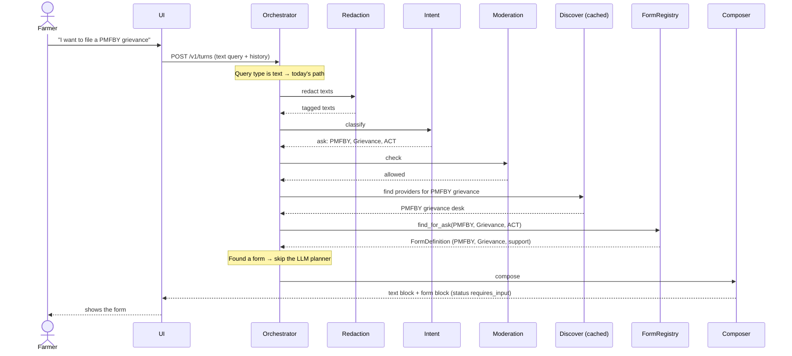

### 2. The farmer submits a valid form: the complaint is filed

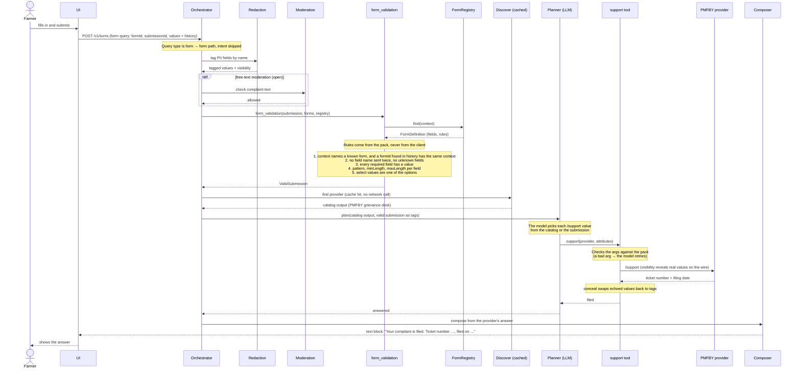

### 3. A value is wrong: the form comes back, nothing is sent

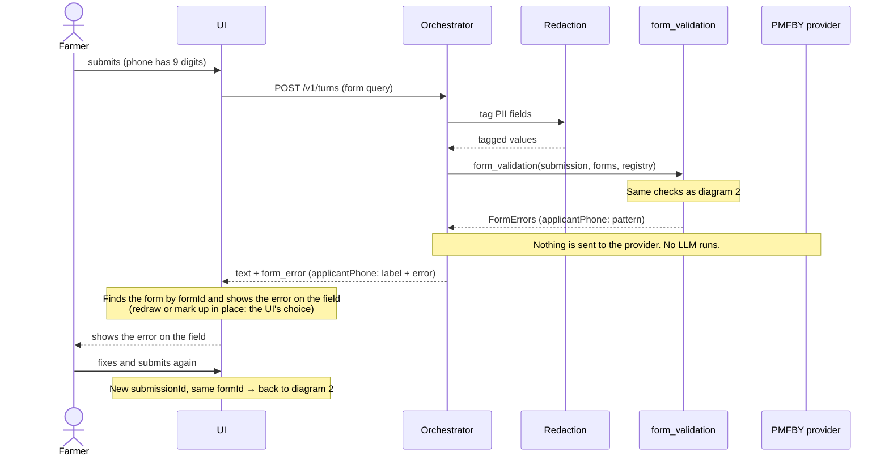

### 4. The provider can't be reached or rejects the filing

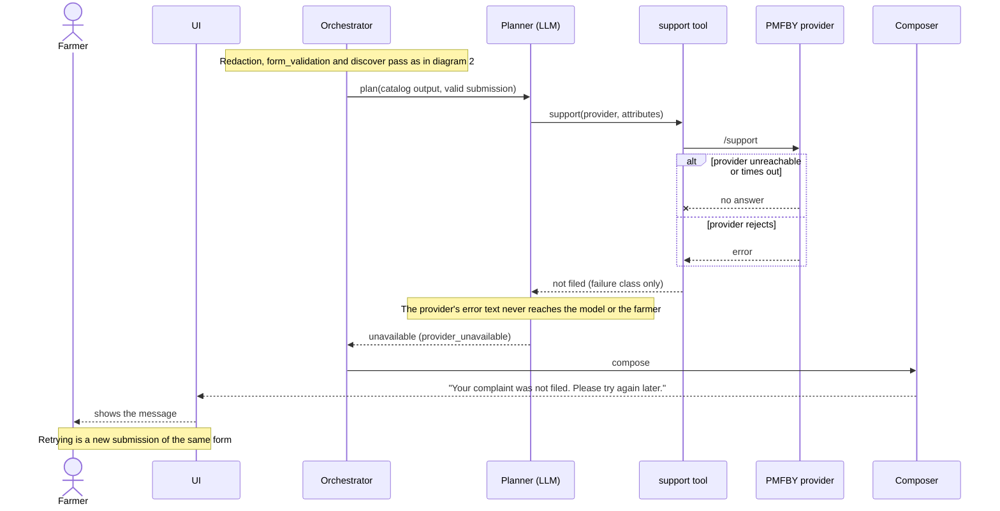

### 5. No provider for the request

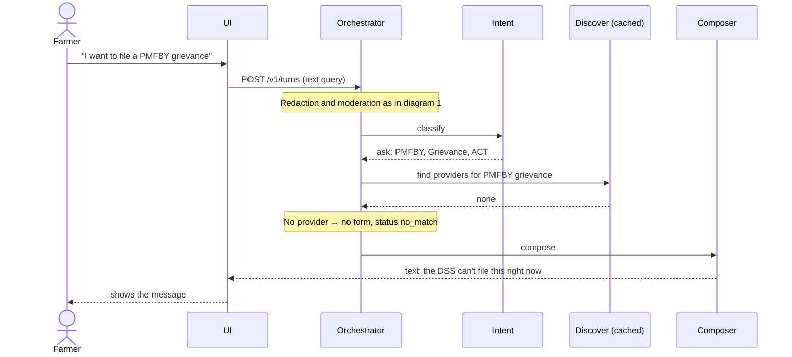

### 6. A form is open and the farmer asks a plain question

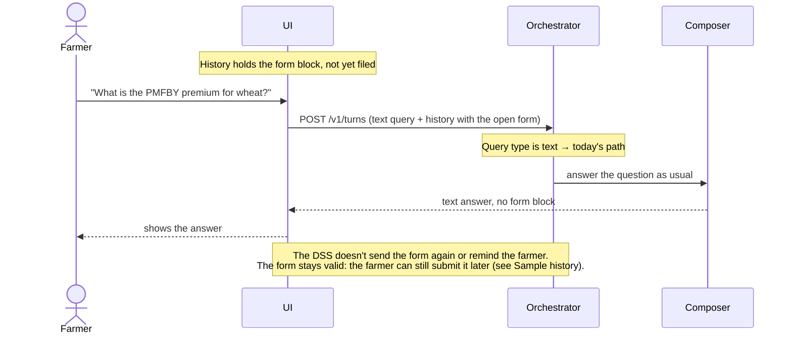

### Sample history: the farmer leaves the form, asks other things, then submits

This is the order the UI sends history in. The content is dummy data.

```text
user:       "I want to file a PMFBY grievance"
assistant:  text + form                        (formId: 8f3c…, context: PMFBY / Grievance / support)

user:       "Tell me the weather"
assistant:  "Here you go …"

user:       "Tell me the weather"
assistant:  "Here you go …"

user:       "Tell me the weather"
assistant:  "Here you go …"

user:       form submission                    (formId, context, submissionId, values)
assistant:  text + form_error                  (formId, submissionId; only the fields that failed)
```

What this means:

- **A form stays valid after other questions.** "The form is dropped" means the DSS stops pushing it. It doesn't send the form again or remind the farmer. If the farmer goes back and submits, the submission is checked and handled as usual. This is a looser reading of the story's acceptance criterion ("the form is dropped"), so the story text should say this.
- **The form may be far back in history.** Intent and moderation read only the last 6 messages, and the composer the last 3. `forms_from_history` must walk the whole history the UI sends, not a window. The UI must keep sending the message that holds the form for as long as the form can be submitted.
- **Text turns now have form items in their history.** In this sample, the three weather turns carry the earlier `form` block in history. The intent, moderation and composer prompts must skip form items, or show them as a short line like "[a form was offered: PMFBY grievance]". They must never send form values to a model.
- **The `form_error` reply lists only what failed.** The UI matches it to the original form by `formId`.

## Agreed

- **Forms are built from the packs.** At startup, the DSS downloads every API schema pack and builds a form for each `(scheme, category, action)`. A `FormRegistry` holds them. When intent matches one, the form is taken from the registry with no LLM.
- **The form key** is `(scheme, category, action)`, for example `(PMFBY, Grievance, support)`. It's derived from the schema pack. Versions are ignored for now.
- **A category can have several actions.** The pack says which, for example PMFBY grievance has `discover`, `support` and `status`.
- **`FormRegistry` is a class**, not a bare map. It wraps a private collection and offers operations like `find`. It's built once and passed to the `Orchestrator`.
- **`formId` is a random UUID** that the DSS creates when it sends a form. It names this one offered form, not its type.
- **`context` carries the form's type**: `scheme`, `category`, `action`. The DSS finds the form in the registry by `context`.
- **The planner on the form path is an LLM tool call.** The model gets the catalog output and the valid submission, picks the values for `/support` from both, and calls the `support` tool, as it does with `select` today. The tool gets `Visibility`, so it can reveal PII on the wire.
- **Fields.** The interaction gives the fields the farmer fills in. The rest come from the catalog.
- **Category list.** `Grievance` is added to the current subject-category enum for now. Pulling categories from the packs needs a redesign of that enum and is later work.
- **One form, many submissions.** A failed filing is filled in again as a new submission on the same form, not as a new form.
- **Consent.** Submitting the form is the farmer's consent to file.
- **Replies to a submission.**
  - Errors come back as a `FormErrorResponse` (`form_error`) block. Each failed field has its name, label and an error string. The DSS never sends values back.
  - A successful filing is only a `text` block, written by the composer with the ticket number and filing date.

## Wire schemas

Field names are camelCase, like the rest of `/v1/turns`.

### Response: the DSS sends a form

The reply's `message.content` gets a new block type, `form`. It comes after a `text` block that introduces it. The turn's `outcome.status` is `requires_input`. On SSE, the form arrives whole in `claim.completed`, never as a delta.

```json
{
  "type": "form",
  "formId": "8f3c2a9e-…",
  "context": { "scheme": "PMFBY", "category": "Grievance", "action": "support" },
  "fields": [
    { "name": "enrolmentId", "label": "Application number", "kind": "text", "required": true, "pattern": "…", "maxLength": 64 },
    { "name": "applicantPhone", "label": "Phone used at enrolment", "kind": "text", "required": true, "pattern": "^[6-9][0-9]{9}$" },
    { "name": "cropYear", "label": "Crop year", "kind": "text", "required": true, "pattern": "^[0-9]{4}$" },
    { "name": "season", "label": "Season", "kind": "select", "required": true,
      "options": [ { "value": "Kharif", "label": "Kharif" }, { "value": "Rabi", "label": "Rabi" }, { "value": "Zaid", "label": "Zaid" } ] },
    { "name": "grievance.description", "label": "What went wrong", "kind": "textarea", "required": true, "minLength": 10, "maxLength": 2000 }
  ]
}
```

- `kind` is one of `text`, `textarea`, `select` or `secret`.
- The only rules are `required`, `pattern`, `minLength`, `maxLength` and `options`.
- `formId` is a random UUID, made by the DSS for this one form.
- `context` is the form's type. The UI treats it as opaque and copies it back.

### Request: the farmer submits

`message.input[].content` gets a new item type, `form`, next to `text`.

```json
{
  "type": "form",
  "formId": "8f3c2a9e-…",
  "context": { "scheme": "PMFBY", "category": "Grievance", "action": "support" },
  "submissionId": "…",
  "fields": [
    { "name": "enrolmentId", "value": "…" },
    { "name": "applicantPhone", "value": "…" },
    { "name": "cropYear", "value": "2026" },
    { "name": "season", "value": "Kharif" },
    { "name": "grievance.description", "value": "…" }
  ]
}
```

- `formId` and `context` are copied from the form the DSS sent.
- A field name sent twice is an error.
- The client checks the values to show errors quickly. The DSS checks them again and does not trust the client.

### History

The UI keeps the session history and sends it back each turn. Forms ride in it:
- an assistant message carries the `form` block the DSS sent, and any `form_error`
- a user message carries the `form` submission

### `FormErrorResponse`: when a submission has errors

This block is sent **only for errors**. A successful filing is a normal `text` block that the composer writes from the provider's answer (ticket number, filing date).

Each field has only its `name`, its `label` and an `error` string. Only the fields that failed are listed.

It goes in the reply's `message.content`, after a `text` block. Like every reply, the turn has an `outcome`. Here it's `requires_input` with cause `invalid_input` (a new cause).

```json
{
  "type": "form_error",
  "formId": "8f3c2a9e-…",
  "context": { "scheme": "PMFBY", "category": "Grievance", "action": "support" },
  "submissionId": "…",
  "fields": [
    { "name": "applicantPhone", "label": "Phone used at enrolment", "error": "Enter the 10-digit phone number used at enrolment." },
    { "name": "grievance.description", "label": "What went wrong", "error": "Write at least 10 characters." }
  ]
}
```

It has the same top-level shape as the `form` block. Only `type` and the `fields` items differ, plus `submissionId` (open, below).

**What the UI does.** It gets the original form by `formId` and shows each `error` on its field. It's up to the UI whether to draw the form again or mark up the form already on screen. The farmer fixes the fields and submits again with a new `submissionId` and the same `formId`.

The DSS never sends the farmer's values back. The UI already has them.

**Rules:**
- `name` matches the field in the original form, and `label` is repeated so the UI can show the error without a lookup.
- `error` is in English and goes through the localizer like other system text.
- A field not listed passed.
- Nothing goes to the provider while any error is present.

**Errors that belong to no field.** These are an unknown `formId` or `context`, a field name sent twice, and a field the form doesn't have.
- A field sent twice, or an unknown field, is listed under its own `name`. Its `label` is empty for an unknown field.
- An unknown `context` (no such form in the registry) has no form to point at. Proposed: the reply is text only.
- A `formId` not found in history, with a known `context`: proposed, accept it, because the form may have scrolled out of what the UI sends. The `context` is enough to check the values.

**Open:**
- Is `submissionId` needed on this block? It's how the forms map knows which submission was rejected (flow D).
- The `invalid_input` cause name.
- Is a failed filing (provider unreachable or rejecting) also a `FormErrorResponse`, so the UI offers the same form again? Or is it plain text only? Today it's text.

## What the orchestrator needs

The pieces, grouped by where they live (hexagonal layout).

### Already there, reused

- **Schema packs.** `SchemaPackSource` (`ports/schema_packs.py`) fetches them. `SchemaPackCache` (`core/provider_discovery/schema_pack_cache.py`) rebuilds its index on `refresh()`, at startup and on a timer.
- **Pack field reading.** `DomainSchema` (`core/planner/validation.py`) already reads field types and formats from `attributes.yaml`.
- **The `select` tool pattern.** The planner's model calls a tool, its arguments are checked against the pack, a bad argument makes the model retry, and `CapabilityInvocation` (`ports/invocation.py`) makes the call with `visibility`. The `support` tool follows the same pattern.
- **Discovery** and its cache.
- **Redaction.** `reveal` / `conceal` already work for provider calls and the reply.
- **The localizer**, for system text in the farmer's language.
- **Turn statuses.** `REQUIRES_INPUT` already exists in `TurnStatus`.

### New in `core/`

- **`core/forms/`**, a new function package:
  - `models.py`: `FormDefinition`, `FormSubmission`, `FormErrors`, `Form` (one offered form plus its submissions in this session)
  - `registry.py`: `FormRegistry`
  - `service.py`: `build_form` (pack → form) and `form_validation`. Plain functions, tier-1 tested.
- **Planner prompt and tool arguments** for `support`. The model gets the catalog output and the submission's values (as tags), and fills the `/support` attributes from them.
- **Shared models:**
  - `TextQuery | FormQuery` and `forms` on `UserTurn`
  - `FormBlock` and `FormErrorResponse` added to `OutputContent`
  - new `Cause` values: `invalid_input`, and maybe `provider_rejected` to tell a rejection apart from `provider_unavailable`

### `FormRegistry`

A class around a private collection, not a bare map. Callers only use its operations, so whether it holds a dict or a list inside can change without touching them.

- **Built** from the packs at startup, and refreshed with the pack cache.
- **Passed** to the `Orchestrator` constructor as one object. A refresh replaces its contents inside, so the orchestrator never holds a stale copy.
- **Operations:**
  - `find(context)`: turn 2, from the submission's `context`
  - `find_for_ask(scheme, category, interaction)`: turn 1, from intent
  - `skipped`: packs that couldn't become a form, for operators

**The key.** Each form carries its own `scheme`, `category` and `action` as attributes, for example `(PMFBY, Grievance, support)`. The registry indexes on those. The form sent to the UI carries the same three as `context`, and the submission copies it back, so `find(context)` is exact. `formId` is a random UUID for the one offered form, and isn't used to find its type.

**Turn 1 doesn't name the action.** Intent gives `(PMFBY, Grievance, ACT)`. The pack lists several actions for a category (`discover`, `support`, `status`), so `find_for_ask` needs a rule to pick one. "Filing" means `support` and "checking" means `status`, but intent today only says `ACT`. Open: does intent learn the action, or does the registry map from the farmer's words? Story 2 (checking status) needs the answer.

### New ports and adapters

- **A `support` call.** `CapabilityInvocation` gets a `support(...)` method next to `select(...)`, with the same shape: a capability, the attributes (holding tags), the transaction id, and `visibility`. Its failure must keep only the failure class, never the provider's text. `SelectFailedError.detail` holds provider text today, so neither the model nor the composer may read it.
- **HTTP mapping** (`adapters/http/v1/`):
  - accepts `form` content items in the current message and in history
  - builds `FormQuery` and `forms`
  - emits the `form` and `form_error` blocks, each as a whole block in `claim.completed` on SSE

### New in `orchestration/`

- **A router at the top of `Orchestrator.run`.** It switches on the query type:
  - `TextQuery` → today's path, unchanged
  - `FormQuery` → `_run_form_submission`

  Both share the turn span, `TurnStarted`, the turn sink and `_reveal_to_farmer`. Where redaction sits depends on the open question about the order of validation and redaction.
- **Turn-1 form step.** After discovery, if the registry has a form for the ask, return `requires_input` with the form. This happens before the LLM planner and is never decided by it.
- **`_run_form_submission`.** It runs `form_validation` → discovery (cache) → LLM planner with the `support` tool → composer. Intent doesn't run. Validation errors return right away with no LLM.
- **The `support` tool** on the planner agent, next to `select`. It checks the model's arguments against the pack, raises `ModelRetry` on a bad one, and calls `CapabilityInvocation.support` with `visibility`.
- **Composition root.** Builds the `FormRegistry` and passes it to the `Orchestrator`, and wires the `support` tool.

### Data flow

Each diagram follows one piece of data from where it starts to where it ends. Boxes are types, and arrows are the functions that turn one type into the next. Under each diagram, the steps are listed in the same order, with signatures. All names are proposals.

#### A. At startup: packs → `FormRegistry`

Runs at boot, and again on every pack refresh. No farmer is involved.

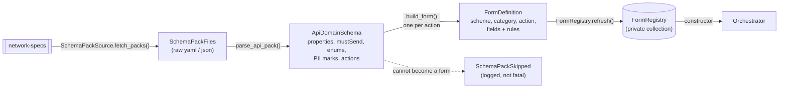

| # | In | Function | Out |
|---|---|---|---|
| A1 | network-specs checkout | `SchemaPackSource.fetch_packs() -> tuple[SchemaPackFiles, ...]` (exists) | raw files per pack |
| A2 | `SchemaPackFiles` | `parse_api_pack(files) -> ApiDomainSchema \| SchemaPackSkipped` | the pack, typed: each property's type, `pattern`, length limits, enum and `x-enum-details` labels, PII mark, the `mustSend` list, and the actions it supports |
| A3 | `ApiDomainSchema` | `build_form(schema, action) -> FormDefinition` | farmer fields = `mustSend ∩ properties`, minus what the catalog supplies; each a `FieldDefinition` with label, kind and rules |
| A4 | `FormDefinition`s | `FormRegistry.refresh(definitions) -> None` | replaces the registry's contents; a duplicate key is skipped and logged |
| A5 | `FormRegistry` | passed to `Orchestrator(..., forms=registry)` | one object for the process's life |

`ApiDomainSchema` sits next to today's `DomainSchema` (`core/planner/validation.py`). That one holds what the planner needs to check a `select`. This one holds what a form and a `support` call need. Whether they merge into one type is open.

#### B. Turn 1: the farmer asks → a form goes out

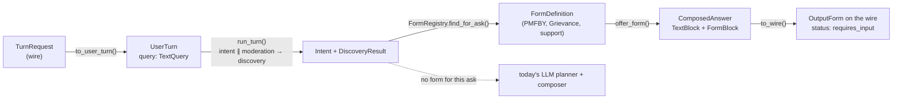

| # | In | Function | Out |
|---|---|---|---|
| B1 | `TurnRequest` | `to_user_turn(request) -> UserTurn` | `query` is `TextQuery`. `forms` comes from history (flow D) |
| B2 | `UserTurn` | `run_turn(...)` (exists) | `Intent`, and `DiscoveryResult` with the PMFBY grievance provider |
| B3 | `Intent.asks[i]` | `FormRegistry.find_for_ask(scheme, category, interaction) -> FormDefinition \| None` | `None` → the turn carries on down today's path. How `ACT` becomes `support` is open |
| B4 | `FormDefinition` | `offer_form(definition) -> ComposedAnswer` | an intro `TextBlock`, and a `FormBlock` with a new UUID `formId`, the `context`, and only the farmer's fields |
| B5 | `ComposedAnswer` | localizer on the text (exists) → `to_wire()` | `OutputText` + `OutputForm`, status `requires_input` |

#### C. Turn 2: the farmer submits → filed, errors, or not filed

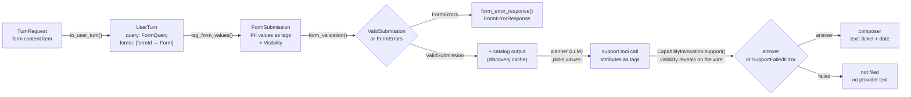

| # | In | Function | Out |
|---|---|---|---|
| C1 | `TurnRequest` | `to_user_turn(request) -> UserTurn` | `query` is `FormQuery(submission)`, and `forms` comes from history |
| C2 | `FormSubmission` | `tag_form_values(submission, definition) -> tuple[FormSubmission, Visibility]` | fields marked PII swapped for tags by name. Where this sits relative to C3 is open |
| C3 | `FormSubmission`, `UserTurn.forms`, `FormRegistry` | `form_validation(submission, forms, registry) -> ValidSubmission \| FormErrors` | rules from the registry, never the client |
| C4 | `FormErrors` | `form_error_response(errors, definition) -> ComposedAnswer` | intro text + `FormErrorResponse` (name, label, error per failed field). No LLM |
| C5 | `FormDefinition` (scheme, category) | `DiscoverProviders(...)` (exists, served from cache) | the catalog output: `ProviderCapability` and what the catalog publishes |
| C6 | catalog output + `ValidSubmission` | planner agent run, with the `support` tool | the model picks each `/support` attribute from the catalog or the submission and calls the tool |
| C7 | the tool's arguments | `check_support_args(args, schema)`, then `CapabilityInvocation.support(capability, attributes, transaction_id, visibility=...)` | the provider's answer, or `SupportFailedError` with the failure class only. A bad argument → `ModelRetry` |
| C8a | the provider's answer | composer, with the answer as evidence | a `text` block with the ticket number and filing date; status `answered` |
| C8b | `SupportFailedError` | `not_filed_answer(failure) -> ComposedAnswer` | fixed text through the localizer; status `unavailable` |

#### D. History → the `forms` map

Runs inside `to_user_turn` on every turn, text or form.

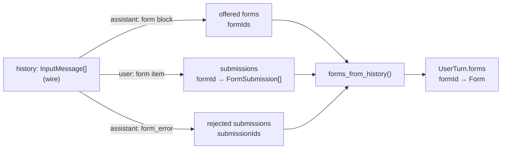

| # | In | Function | Out |
|---|---|---|---|
| D1 | `list[InputMessage]` | `forms_from_history(history) -> dict[str, Form]` | one `Form` per offered `formId`, holding its submissions and which of them were rejected |
| D2 | `Form` | read by `form_validation` (C3) | when the `formId` is found, its `context` must match the submission's |

A success is plain text, so history can't show that a form was already filed. The DSS can't stop a second filing on the same form by itself. Protection against filing twice rests on `submissionId` as a duplicate key at the provider, which is still open.

With `formId` a random UUID, a session can hold several forms of the same type. Each gets its own `formId`.

#### E. Where the orchestrator branches

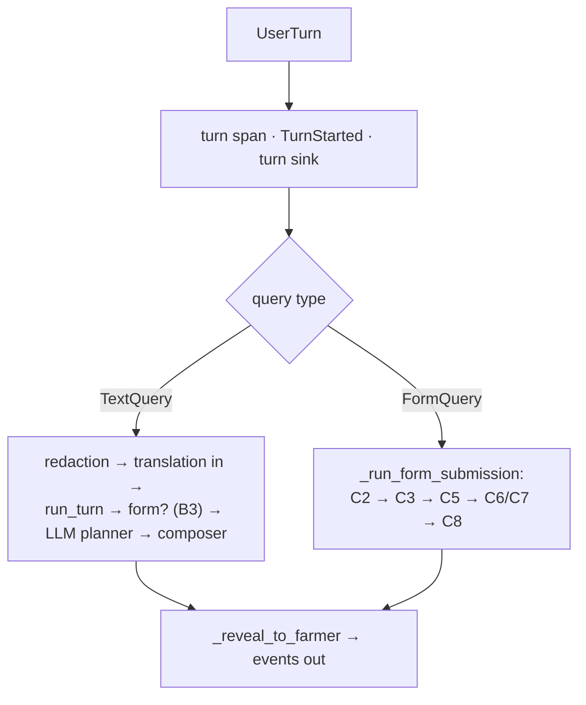

<details>
<summary>Types used above</summary>

#### `core/forms/models.py`

```python
class FieldKind(StrEnum):
    TEXT = "text"
    TEXTAREA = "textarea"
    SELECT = "select"
    SECRET = "secret"


class Option(BaseModel):
    value: str
    label: str             # from x-enum-details


class FieldRules(BaseModel):
    required: bool = False
    pattern: str | None = None
    min_length: int | None = None
    max_length: int | None = None
    options: tuple[Option, ...] = ()


class FieldDefinition(BaseModel):
    name: str              # the pack's path, e.g. "grievance.description"
    label: str
    kind: FieldKind
    rules: FieldRules
    pii: bool = False      # from the pack's never-log / never-trace mark


class FormDefinition(BaseModel):
    """One fillable form, cut from one API schema pack for one action."""
    scheme: str            # "PMFBY"
    category: str          # "Grievance"
    action: str            # "support"
    fields: tuple[FieldDefinition, ...]   # the farmer's fields only; the catalog supplies the rest

    @property
    def context(self) -> FormContext: ...

    def field(self, name: str) -> FieldDefinition | None: ...


class FormContext(BaseModel):
    """The form's type. Sent with the form, copied back with the submission."""
    scheme: str
    category: str
    action: str


class FieldValue(BaseModel):
    name: str
    value: str


class FormSubmission(BaseModel):
    form_id: str
    context: FormContext
    submission_id: str
    values: tuple[FieldValue, ...]   # a tuple, not a dict, so duplicates survive to be reported


class Form(BaseModel):
    """One form offered in this session, and everything sent against it.
    Rebuilt from history every turn; the DSS stores nothing."""
    form_id: str
    context: FormContext
    submissions: tuple[FormSubmission, ...] = ()
    rejected: frozenset[str] = frozenset()   # submission ids that got a form_error


class FieldErrorCode(StrEnum):
    REQUIRED = "required"
    PATTERN = "pattern"
    MIN_LENGTH = "min_length"
    MAX_LENGTH = "max_length"
    NOT_AN_OPTION = "not_an_option"
    DUPLICATE = "duplicate"
    UNKNOWN_FIELD = "unknown_field"


class FieldError(BaseModel):
    name: str
    code: FieldErrorCode   # internal, for metrics; the wire gets only the message
    message: str           # English; localized on the way out


class FormErrors(BaseModel):
    """Why a submission was not sent. Never empty."""
    form_id: str
    submission_id: str
    field_errors: tuple[FieldError, ...] = ()
    unknown_form: bool = False


class ValidSubmission(BaseModel):
    """A submission that passed form_validation. One value per field name."""
    definition: FormDefinition
    submission_id: str
    values: Mapping[str, str]   # PII values are tags
```

#### `core/forms/registry.py`

```python
class FormRegistry:
    """The forms built from the API schema packs. A class around a private
    collection: callers use its operations, never the collection itself."""

    def __init__(self) -> None:
        self._forms: dict[FormContext, FormDefinition] = {}   # by type; a list would do too
        self._skipped: tuple[SchemaPackSkipped, ...] = ()

    def refresh(self, packs: Sequence[SchemaPackFiles]) -> None:
        """Rebuild from the packs. Called at startup and with the pack cache's refresh."""

    def find(self, context: FormContext) -> FormDefinition | None: ...

    def find_for_ask(
        self, scheme: str, category: str, interaction: InteractionType
    ) -> FormDefinition | None:
        """How `interaction` picks the action (support, status) is open."""

    @property
    def skipped(self) -> tuple[SchemaPackSkipped, ...]: ...
```

#### `core/forms/service.py`

```python
def parse_api_pack(files: SchemaPackFiles) -> ApiDomainSchema | SchemaPackSkipped: ...


def build_form(schema: ApiDomainSchema, action: str) -> FormDefinition:
    """Farmer fields are mustSend ∩ properties, minus what the catalog supplies."""


def form_validation(
    submission: FormSubmission,
    forms: Mapping[str, Form],        # from UserTurn.forms
    registry: FormRegistry,
) -> ValidSubmission | FormErrors:
    """Rules come from the registry, never from the client."""


def check_field(field: FieldDefinition, value: str | None) -> FieldError | None: ...


def offer_form(definition: FormDefinition) -> ComposedAnswer: ...          # intro text + FormBlock
def form_error_response(errors: FormErrors, definition: FormDefinition) -> ComposedAnswer: ...   # intro text + FormErrorResponse
def not_filed_answer(failure: FailureClass) -> ComposedAnswer: ...         # fixed text, English
```

#### `core/shared/models.py` changes

```python
class TextQuery(BaseModel):
    type: Literal["text"] = "text"
    original: str
    enriched: str


class FormQuery(BaseModel):
    type: Literal["form"] = "form"
    submission: FormSubmission


Query = Annotated[TextQuery | FormQuery, Field(discriminator="type")]


class ConversationMessage(BaseModel):
    role: Literal["user", "assistant"]
    text: str | None = None
    form: FormBlock | FormSubmission | FormErrorResponse | None = None


class UserTurn(BaseModel):
    query: Query                                   # replaces original_query / enriched_query
    forms: Mapping[str, Form] = {}                 # built from history by the HTTP mapping
    ...                                            # everything else unchanged


class FormBlock(BaseModel):
    """The `form` content block."""
    form_id: str                                   # a new UUID per offered form
    context: FormContext
    fields: tuple[FieldDefinition, ...]            # label, kind, rules


class FieldErrorEntry(BaseModel):
    name: str
    label: str
    error: str             # English; localized on the way out


class FormErrorResponse(BaseModel):
    """The `form_error` block. Like a form, but only the failed fields, each with its error."""
    form_id: str
    context: FormContext
    submission_id: str
    fields: tuple[FieldErrorEntry, ...]


OutputContent = TextBlock | RefusalBlock | FormBlock | FormErrorResponse


class Cause(StrEnum):
    ...
    INVALID_INPUT = "invalid_input"
    PROVIDER_REJECTED = "provider_rejected"        # maybe
```

#### `ports/invocation.py` changes

```python
class SupportFailedError(Exception):
    """Carries the failure class only. No provider text, so neither the model
    nor the composer can leak it."""
    capability: str
    failure_class: FailureClass


class CapabilityInvocation(Protocol):
    async def select(...) -> Sequence[DiscoveredAnswer]: ...   # unchanged

    async def support(
        self,
        capability: ProviderCapability,
        attributes: dict,                          # holds tags
        transaction_id: NetworkTransactionID,
        *,
        visibility: Visibility = NOTHING_HELD,     # reveal on the wire, conceal the echo
    ) -> DiscoveredAnswer: ...                     # or raises SupportFailedError
```

#### `adapters/http/v1/` changes

```python
class FormFieldValue(_WireIn):
    name: str
    value: str


class FormContent(_WireIn):
    """A form item in an input message: a submission (user) or the block the DSS sent (assistant)."""
    type: Literal["form"]
    form_id: str
    context: WireFormContext
    submission_id: str | None = None
    fields: list[FormFieldValue | WireFormField]


class WireFieldError(_WireIn):
    name: str
    label: str
    error: str


class FormErrorContent(_WireIn):
    type: Literal["form_error"]
    form_id: str
    context: WireFormContext
    submission_id: str
    fields: list[WireFieldError]


class InputMessage(_WireIn):
    role: Literal["user", "assistant"]
    content: list[Annotated[
        TextContent | FormContent | FormErrorContent,
        Field(discriminator="type"),
    ]]


class OutputForm(_WireOut):
    type: Literal["form"] = "form"
    form_id: str
    context: WireFormContext
    fields: list[WireFormField]


class OutputFormError(_WireOut):
    type: Literal["form_error"] = "form_error"
    form_id: str
    context: WireFormContext
    submission_id: str
    fields: list[WireFieldError]


# mapping.py
def to_user_turn(request: TurnRequest) -> UserTurn: ...
def forms_from_history(history: Sequence[InputMessage]) -> dict[str, Form]: ...
```

#### `orchestration/`

```python
class Orchestrator:
    def __init__(self, *, ..., forms: FormRegistry) -> None: ...

    async def run(self, turn: UserTurn, ctx: TurnContext) -> AsyncIterator[TurnEvent]:
        # span, TurnStarted, redaction, turn sink: shared
        match turn.query:
            case TextQuery():
                events = self._run_core(...)                 # today's path
            case FormQuery(submission=submission):
                events = self._run_form_submission(...)
        # _reveal_to_farmer: shared

    async def _run_core(...) -> AsyncGenerator[CoreEvent]:
        # unchanged up to discovery, then:
        form = self._form_for(intent, discovery)
        if form is not None:
            yield _build_turn_finished(outcome_for(TurnStatus.REQUIRES_INPUT), form)
            return
        # LLM planner and composer as today

    def _form_for(self, intent: Intent, discovery: DiscoveryResult) -> ComposedAnswer | None:
        """offer_form(...) when a provider exists and the registry has a form for the ask."""

    async def _run_form_submission(
        self,
        submission: FormSubmission,
        turn: UserTurn,
        *,
        ctx: TurnContext,
        recorder: TurnRecorder,
        visibility: Visibility,
    ) -> AsyncGenerator[CoreEvent]:
        """form_validation → discovery (cache) → planner with the support tool → composer.
        Validation errors return straight away, with no LLM."""


# The planner agent gains a tool next to `select`:
async def support(
    ctx: RunContext[PlannerDeps],
    capability_id: str,
    attributes: dict,              # the model's picks from the catalog and the submission, as tags
) -> str:
    """Checks the attributes against the pack (ModelRetry on a bad one), then calls
    CapabilityInvocation.support(..., visibility=ctx.deps.visibility)."""
```

#### `observability/stages.py`

```python
class Stage(StrEnum):
    ...
    FORM_VALIDATION = "form_validation"
```

The `support` call runs inside the existing `PLANNER` stage, as `select` does.

</details>

### Telemetry

- **A new `FORM_VALIDATION` stage.** Stage names are a dashboard contract (`observability/stages.py`), so `grafana/dashboards/dss.json` gets the new panel.
- **Counts:** forms sent, submissions, validation failures by rule (the internal code, never sent on the wire), and `support` calls by outcome. Never a field value.

### Docs

- **`docs/DSS_ARCHITECTURE.md`:** the form path, the new content types and the registry.
- **An ADR:** a second entry path and new wire content types are design choices with trade-offs.

## `UserTurn` changes

### The query: two types, not a nullable field

Recommended: `query: TextQuery | FormQuery`, with a `type` field to tell them apart.

- **Making `original_query` nullable** means all 9 files that read it must handle `None`. The type also can't say "one or the other": a turn with neither a query nor a form would still be valid.
- **Two types** make the orchestrator's top-level branch a simple check on which type arrived. The text path's code stays as it is. `enriched_query` moves onto `TextQuery`, because a form has no "enriched" version.

### The `forms` map

`UserTurn` gets `forms: dict[formId, Form]`. Each form holds its submissions and which of them were rejected. A success is plain text, so the map can't show that a form was filed.

The DSS keeps nothing between turns, so the map can only come from what the UI sends. The UI keeps the session history, so history carries the forms (see "History" in the wire schemas).

The DSS builds `forms` from history in the HTTP mapping (`adapters/http/v1/mapping.py`). It walks history once and groups everything by `formId`. The alternative, a separate `forms` field on the wire, makes the UI keep a second copy of state in step with history.

The form's rules don't come back from the UI. The DSS finds the form in the registry by `context` and checks values against that. The DSS needs the old form block in history only to know a form was offered.

### What this changes

`ConversationMessage` holds only `text: str` today, and the wire `InputMessage.content` only accepts `text`. Both need to accept form items: the form and any `form_error` on assistant messages, and submissions on user messages.

## Redaction

Today redaction flattens a turn into a list of texts and puts them back in the same order (`texts_of` / `with_texts` in `core/redaction/turn.py`). It covers the query, the enriched query, the history and the user's phone. Form values in the current turn and in history must join that list.

- **We already know which fields are PII.** The pack marks fields like `enrolmentId` as never-log and never-trace. Those fields could be tagged by name instead of running the detectors over them. This also covers the application number, which today's detectors don't catch.
- **The planner's model only sees tags.** It picks `/support` values from the submission as tags, like `«enrolment_1»`. The `support` tool's `visibility` reveals them on the wire, so no real value reaches the model or the trace.
- **Order of steps.** Once a value is tagged, the phone is `«phone_1»` and fails its `^[6-9][0-9]{9}$` check. The check needs the real values. That means either checking before redaction, or checking against values put back from the tags. This also decides where the form branch splits off:
  - **before redaction:** the form path runs check → tag → planner
  - **after redaction:** both paths share redaction, and the form path checks against values put back from the tags

## Follow-ups

- **Update the frontend comment on #205:**
  - `formId` is a random UUID; `context` becomes `{ scheme, category, action }`
  - add `FormErrorResponse` (`form_error`)
  - say that history carries form items back

## Open

Logged to standup 2026-10-26:

- Who creates `submissionId`: the client or the DSS? Can the PMFBY provider take it as a key to drop duplicates? Without one, a retry or a double tap could file twice.
- How the pack marks which fields come from the catalog and which from the farmer.
- Should values be checked before redaction or after?
- Does the free-text complaint go through moderation? It's the only field in the farmer's own words.

Not yet logged:

- How intent's `ACT` picks between a category's actions (`support`, `status`).
- Is a failed filing a `FormErrorResponse` too, or text only?
- Do `ApiDomainSchema` and today's `DomainSchema` merge?
